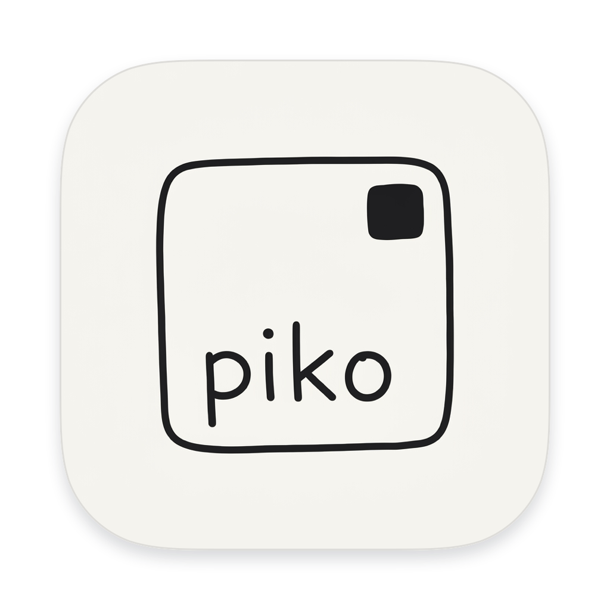

<div align="center">
  
  <h1>
    Piko
  </h1>
  <p>
    轻巧随手的 macOS 桌面悬浮工作台 —— 集任务规划板、番茄钟、剪贴板历史、富文本/Markdown 随笔与右上角迷你小窗于一体。
  </p>
</div>

## 核心模块

* **规划板**：双向同步 Apple 提醒事项，支持周/月/年日程排期、当日时间轴拖拽、跨栏即时完成与撤回、已完成时间筛选
* **番茄钟**：专注与长短休息倒计时，支持绑定规划板任务、顶部菜单栏实时倒计时与今日专注统计
* **剪贴板**：自动记录文字与图片历史，支持搜索、收藏置顶与一键回填
* **随笔**：支持富文本快捷样式与所写即所见 Markdown 实时排版，选中文本可一键发送到规划板
* **右上角迷你小窗**：按 `⌥⌘M` 或点击顶栏按钮一键收拢至屏幕右上角，四模块无缝切换

## 构建与打包

需要 macOS 12+ 与 Xcode Command Line Tools：

```bash
python3 scripts/build_app.py
```

构建产物位于 `build/Piko.app`。

## 权限说明

Piko 通过系统 [EKEventStore](https://developer.apple.com/documentation/eventkit/ekeventstore) 同步 Apple 提醒事项数据（支持 iCloud 同步）。首次使用时需在 *系统设置 > 隐私与安全性 > 提醒事项* 中授予权限。

## 致谢与协议

本项目最初基于 [reminders-menubar](https://github.com/DamascenoRafael/reminders-menubar) 二次演进，遵循 GNU General Public License v3 协议。

## Languages

🇺🇸 English • 🇧🇷 Brazilian Portuguese • 🇨🇳 Chinese (Simplified and Traditional) • 🇨🇿 Czech • 🇳🇱 Dutch • 🇵🇭 Filipino • 🇫🇷 French • 🇩🇪 German • 🇮🇩 Indonesian • 🇮🇹 Italian • 🇯🇵 Japanese • 🇰🇷 Korean • 🇵🇱 Polish • 🇷🇺 Russian • 🇸🇰 Slovak • 🇲🇽 Spanish (Latin America) • 🇹🇷 Turkish • 🇺🇦 Ukrainian • 🇻🇳 Vietnamese

[▶︎ Click here to learn how to add new languages :globe_with_meridians:](docs/adding-new-languages.md)

## License

This project is licensed under the terms of the GNU General Public License v3.0.  
See [LICENSE](LICENSE) for details.
